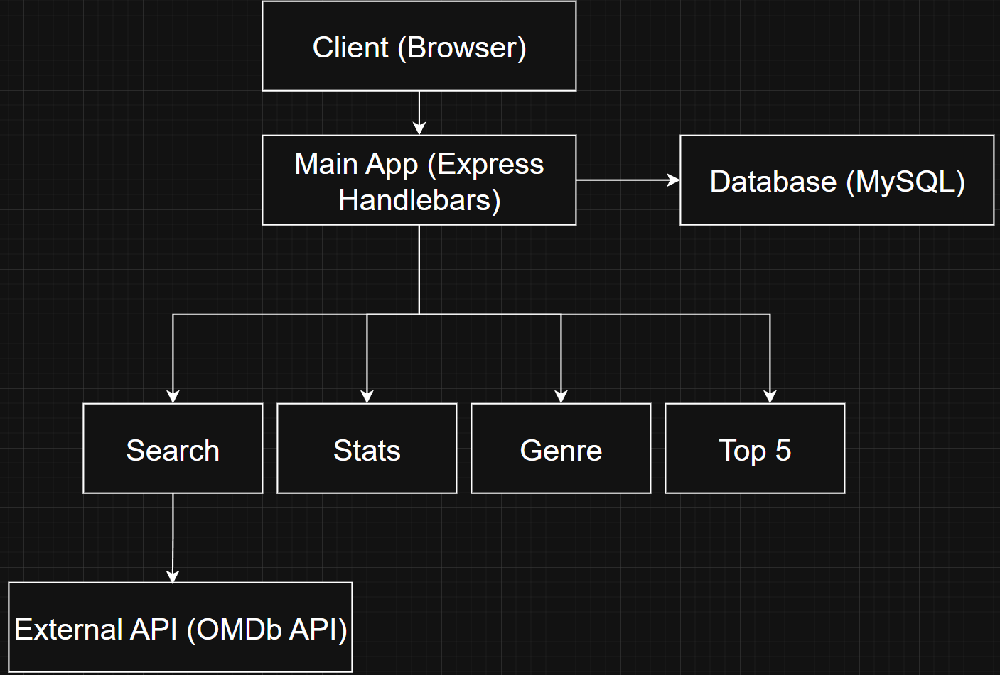

# Movie-Review-Micro

A microservice-based movie review app that allows users to search for movies, build a catalog, and create personal movie reviews.

Built with Node.js, Express, MySQL, and Handlebars. This project utilizes a microservice architecture, RESTful APIs, database CRUD operations, and service communication.

# Demo

The link below is a short demonstration of the application

Link: https://youtu.be/nQ-aQu53DRc

The demo showcases:
- Independent microservice operation
- Application UI and navigation
- Movie search with OMDb API
- Adding and deleting movies from the personal catalog
- Creating, updating, and removing movie reviews
- Sorting movie catalog by genre
- Generating statistics (e.g., average movie rating.)

# Features

- Search for movies using OMDb API
- Maintain a personal movie catalog
- Add, update, and remove movie ratings and reviews
- Filter and sort movies by genre
- View statistics about movies in the personal catalog
- Display the top 5 rated movies
- Microservice-based architecture with HTTP communication

# Architecture

The application uses a microservices architecture, where each service is responsible for a specific domain.

- Services are independently executable
- Communication between services occurs via HTTP requests using Axios
- The main application acts as an orchestrator, coordinating requests between services.

   

# Services

Each service is independently deployable and communicates via HTTP requests

## Main Application
- Handles routing and UI rendering using Handlebars
- Orchestrates communication between microservices
- Performs CRUD operations for the movie catalog database

## Search Service
- Fetches movie data based on user input
- Integrates with the OMDb API

## Stats Service
- Calculates statistics from the movie catalog, including
    - Average movie rating
    - Highest rated movie
    - Lowest rated movie

## Genre Service
- Filters and organizes movies by genre

## Top Five Service (Team Contribution)
- Returns the top 5 highest-rated movies
- Implemented by a collaborating team member

# Tech Stack

- Backend: Node.js, Express
- Frontend: Handlebars (server-rendered views)
- Database: MySQL
- API Communication: Axios
- External API: OMDb API

# How to Run Locally

Each microservice must be running for ffull functionality

1. Clone the repository
```bash
git clone https://github.com/your-username/Movie-Review-Micro.git
cd Movie-Review-Micro
```
2. Install dependencies

Navigate to each service directory and run
```bash
npm install
```
3. Set up MySQL

Create a database: 
```sql
CREATE DATABASE movies;
```
Then run the following schema:
```sql
CREATE TABLE Movie (
    movie_ID        INT NOT NULL AUTO_INCREMENT,
    title           VARCHAR(255) NOT NULL,
    release_year    YEAR NOT NULL,
    director        VARCHAR(255) NOT NULL,
    plot            TEXT NOT NULL,
    rating          DECIMAL(4,2),
    runtime         VARCHAR(255) NOT NULL,
    poster          TEXT,
    genre           VARCHAR(255) NOT NULL,
    review          MEDIUMTEXT,
    PRIMARY KEY     (movie_ID)
    );
```
Update database connection settings in: Main-app/db-connector.js
- Update host
- Update user
- Update password

4. Start each microservice

Run each service in a separate terminal: 

```bash
# Main-app: 
node app.js

# search-micro 
node search.js

# stats-micro 
node stats.js

# genre-micro 
node genre.js

# Microservice-A 
 node app.js
```

5. Open the application

Go to:

```text
 http://localhost:3000
```

    

